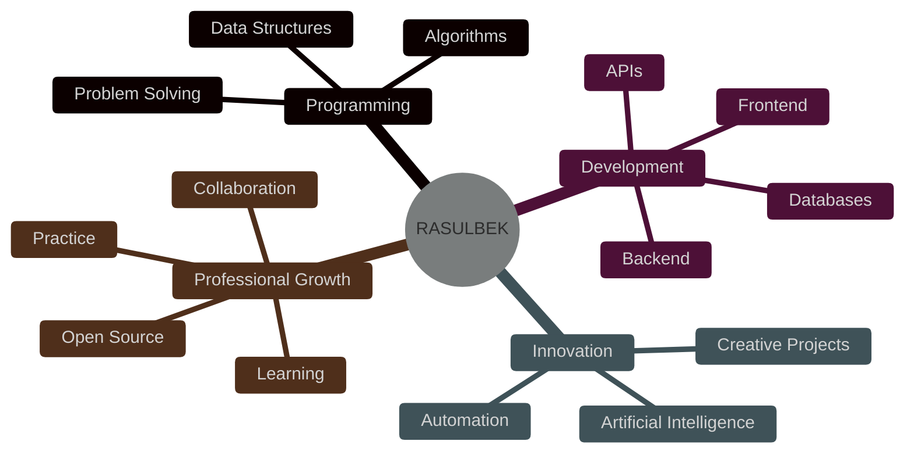
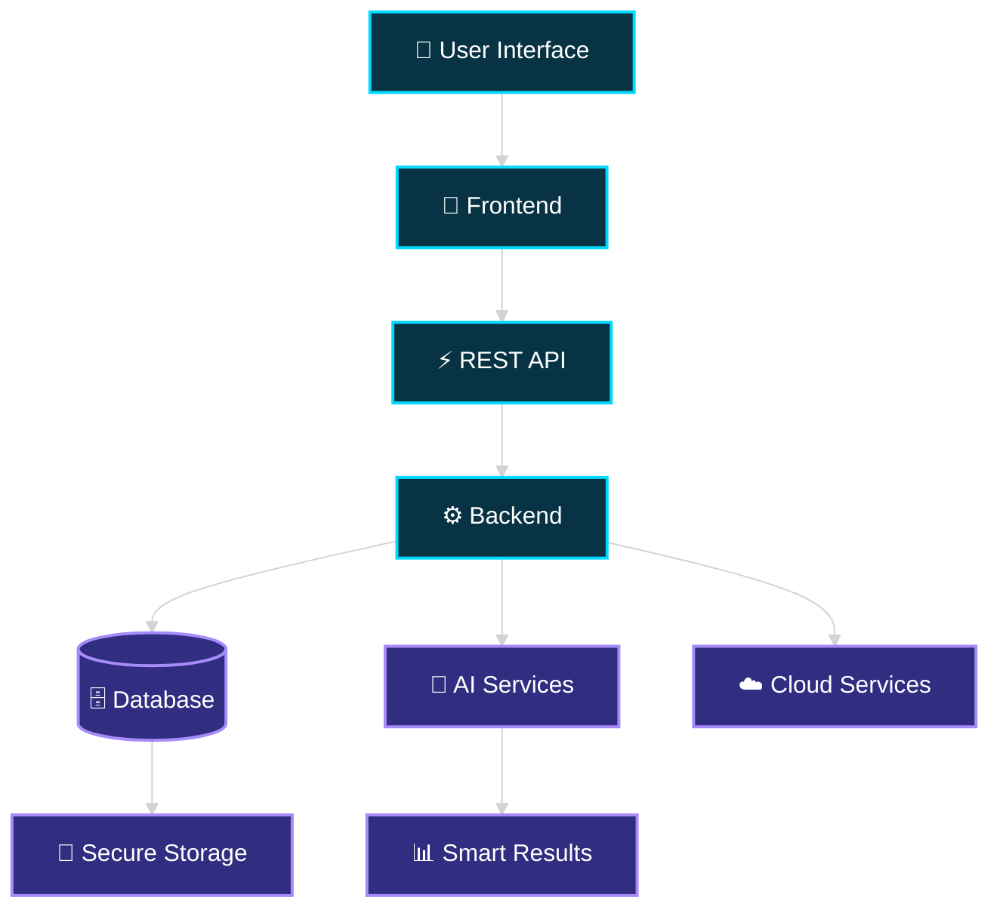
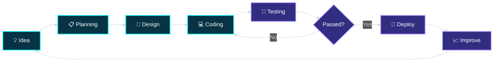
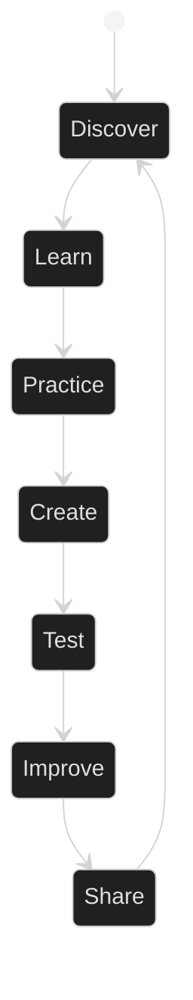
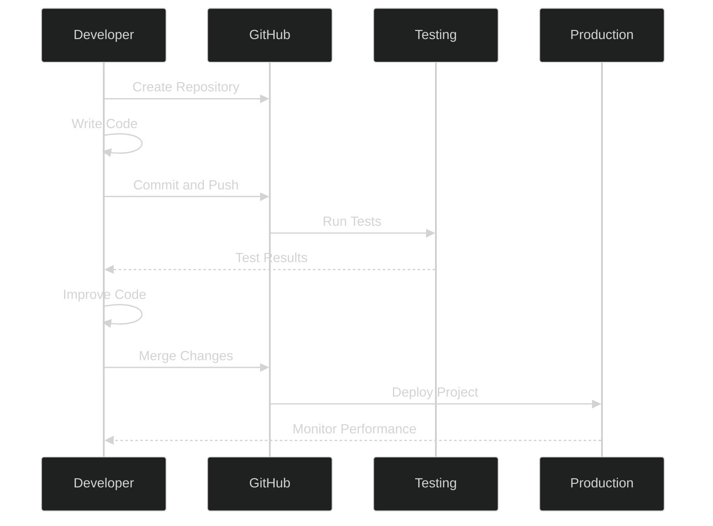
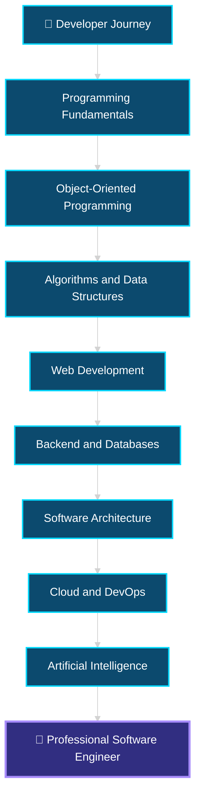
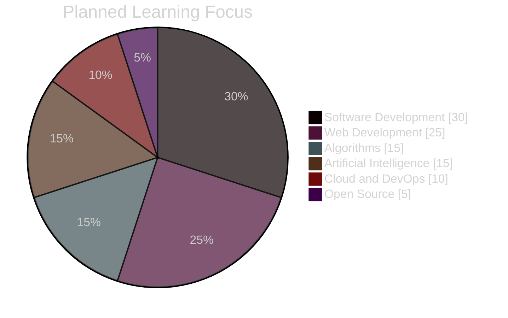
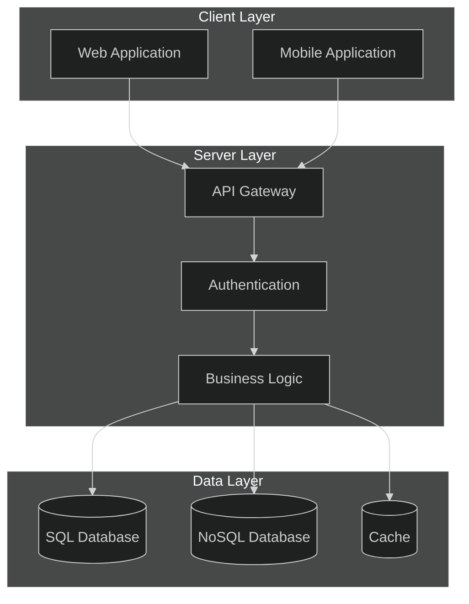
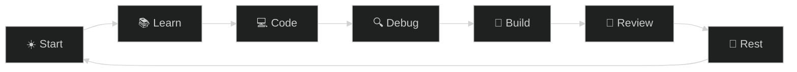

<!-- ══════════════════════════════════════════════════════ -->
<!--             RASULBEK AMINBOYEV | GITHUB PROFILE       -->
<!--                   CYBER NEON EDITION                   -->
<!-- ══════════════════════════════════════════════════════ -->

<div align="center">


<a href="https://github.com/Rasulbek917">

</a>


<br/><br/>


</div>

<!-- ═══════════ ANIMATED SEPARATOR ═══════════ -->


# 🌌 Welcome to My Digital Universe

<div align="center">

[🇺🇿 O'zbekcha](#-uzbekcha) •
[🇷🇺 Русский](#-русский) •
[🇬🇧 English](#-english)

</div>


## 🇺🇿 Uzbekcha

Assalomu alaykum! Men **Rasulbek Aminboyev**.

Dasturlash, zamonaviy texnologiyalar va innovatsion
loyihalarga qiziqaman.

- 💻 Dasturlash bo'yicha bilimlarimni oshiraman.
- 🚀 Zamonaviy va foydali loyihalar yaratishga intilaman.
- 🧠 Yangi texnologiyalarni o'rganishni yaxshi ko'raman.
- 🎯 Maqsadim — professional dasturiy ta'minot muhandisi bo'lish.
- 🤝 Hamkorlik va yangi imkoniyatlarga ochiqman.

**Har bir kod qatori — kelajak sari yangi qadam.**

<br clear="both"/>

---

## 🇷🇺 Русский

Привет! Меня зовут **Расулбек Аминбоев**.

Я увлекаюсь программированием, современными
технологиями и созданием цифровых решений.

- 💻 Развиваю навыки программирования.
- 🚀 Стремлюсь создавать полезные проекты.
- 🌱 Постоянно изучаю новые технологии.
- 🎯 Моя цель — стать профессиональным разработчиком.
- 🤝 Открыт к сотрудничеству и новым возможностям.

**Каждая строка кода — шаг в будущее.**

---

## 🇬🇧 English

Hello! I'm **Rasulbek Aminboyev**, a passionate
developer and technology enthusiast.

I enjoy exploring modern technologies, solving
problems, and transforming ideas into digital solutions.

- 💻 Passionate about software development.
- 🚀 Building and exploring creative projects.
- 🌱 Continuously learning new technologies.
- 🧠 Improving my problem-solving skills.
- 🎯 Aspiring to become a professional software engineer.
- 🤝 Open to collaboration and new opportunities.

**Every line of code is a step toward the future.**

<!-- ═══════════ DEVELOPER TERMINAL ═══════════ -->

# 🖥️ Developer Terminal

```bash
$ whoami

> Rasulbek Aminboyev

$ github --username

> Rasulbek917

$ developer --status

> ONLINE

$ developer --location

> Uzbekistan 🇺🇿

$ developer --mission

> Learn. Build. Innovate. Repeat.

$ system --check

[OK] Creativity
[OK] Motivation
[OK] Problem Solving
[OK] Continuous Learning
[OK] Future Goals

$ future --initialize

> Loading next chapter...
```

# 👨‍💻 Developer Configuration

```javascript
const developer = {
    fullName: "Rasulbek Aminboyev",
    username: "Rasulbek917",
    country: "Uzbekistan 🇺🇿",

    role: "Aspiring Software Engineer",

    profileLanguages: [
        "Uzbek",
        "Russian",
        "English"
    ],

    interests: [
        "Programming",
        "Software Engineering",
        "Web Development",
        "Artificial Intelligence",
        "Open Source",
        "Modern Technologies"
    ],

    softSkills: {
        creativity: true,
        curiosity: true,
        teamwork: true,
        continuousLearning: true
    },

    currentMission: "Building a better future",

    dailyRoutine() {
        return [
            "Learn",
            "Practice",
            "Build",
            "Improve",
            "Repeat"
        ];
    },

    motto: "Never Stop Learning"
};

console.log(developer);
```

<!-- ═══════════ DEVELOPER ECOSYSTEM ═══════════ -->

# 🧠 Developer Ecosystem



<!-- ═══════════ TECHNOLOGY STACK ═══════════ -->

# ⚡ Technology Universe

<div align="center">

### 💻 Programming Languages


### 🎨 Frontend Development


### ⚙️ Backend Development


### 🗄️ Databases


### ☁️ Cloud & DevOps


### 🛠️ Development Tools


### 🤖 Artificial Intelligence


</div>

<!-- ═══════════ TECHNOLOGY ARCHITECTURE ═══════════ -->

# 🌐 Software Architecture



<!-- ═══════════ GITHUB ANALYTICS ═══════════ -->

# 📊 GitHub Analytics Dashboard

<div align="center">


</div>

# 📈 Programming Languages Analytics

<div align="center">


</div>

<!-- ═══════════ CONTRIBUTION ANALYTICS ═══════════ -->

# 🔥 Contribution Activity Graph

<div align="center">


</div>

# 📡 Advanced Developer Metrics

<div align="center">


<br/>


<br/>


</div>

<!-- ═══════════ ACHIEVEMENTS ═══════════ -->

# 🏆 GitHub Achievements

<div align="center">


</div>

<!-- ═══════════ WORKFLOW DIAGRAM ═══════════ -->

# ⚙️ My Development Workflow



<!-- ═══════════ LEARNING CYCLE ═══════════ -->

# 🔄 Continuous Learning Cycle



<!-- ═══════════ DEVELOPMENT SEQUENCE ═══════════ -->

# 🛰️ Project Development Sequence



<!-- ═══════════ ROADMAP ═══════════ -->

# 🎯 Professional Roadmap



<!-- ═══════════ GOALS DISTRIBUTION ═══════════ -->

# 📊 Learning Priority

> Planned learning distribution — not measured skill levels.



<!-- ═══════════ PROJECT ARCHITECTURE ═══════════ -->

# 🏗️ Modern Application Structure



<!-- ═══════════ DAILY ROUTINE ═══════════ -->

# ⏳ Developer Routine



<!-- ═══════════ GITHUB REPOSITORIES ═══════════ -->

# 📂 Explore My Projects

<div align="center">

<a href="https://github.com/Rasulbek917?tab=repositories">
    
</a>

<a href="https://github.com/Rasulbek917?tab=stars">
    
</a>

</div>

<!-- ═══════════ FUTURE GOALS ═══════════ -->

# 🎯 Mission & Future Goals

| Mission | Maqsad | Цель |
| :--- | :--- | :--- |
| 💻 Master programming | Dasturlashni chuqur o'rganish | Освоить программирование |
| 🚀 Build useful projects | Foydali loyihalar yaratish | Создавать полезные проекты |
| 🤖 Explore AI | Sun'iy intellektni o'rganish | Изучать искусственный интеллект |
| 🌍 Contribute to open source | Open Source rivojiga hissa qo'shish | Участвовать в Open Source |
| 🧠 Improve every day | Har kuni rivojlanish | Развиваться каждый день |

<!-- ═══════════ SYSTEM INFORMATION ═══════════ -->

# 🖥️ System Information

<div align="center">

| Parameter | Status |
| :--- | :--- |
| Developer | Rasulbek Aminboyev |
| GitHub | Rasulbek917 |
| Country | 🇺🇿 Uzbekistan |
| Time Zone | UTC +5 |
| Learning Mode | 🟢 Active |
| Creativity | 🔵 Enabled |
| Collaboration | 🟢 Open |
| Future | 🚀 Loading... |

</div>

<!-- ═══════════ SOCIAL NETWORK ═══════════ -->

# 🌍 Connect With Me

<div align="center">

<a href="https://github.com/Rasulbek917">

</a>

<a href="https://instagram.com/INSTAGRAM_USERNAME">

</a>

<a href="https://t.me/TELEGRAM_USERNAME">

</a>

<a href="mailto:YOUR_EMAIL">

</a>

</div>

<!-- ═══════════ QUOTES ═══════════ -->

# 💭 Developer Philosophy

<div align="center">

### 🇺🇿 Orzu qil. O'rgan. Yarat. Rivojlan.

### 🇷🇺 Мечтай. Учись. Создавай. Развивайся.

### 🇬🇧 Dream. Learn. Create. Evolve.

<br/>


</div>

<!-- ═══════════ FINAL TERMINAL ═══════════ -->

```text
╔══════════════════════════════════════════╗
║          DEVELOPER SYSTEM v2.0           ║
╠══════════════════════════════════════════╣
║ USER       : Rasulbek917                 ║
║ STATUS     : ONLINE                      ║
║ MISSION    : BUILD THE FUTURE            ║
║ LEARNING   : NEVER STOP                  ║
║ CREATIVITY : ENABLED                     ║
║ SUCCESS    : IN PROGRESS                 ║
╚══════════════════════════════════════════╝
```

<div align="center">


### ⭐ If you like my projects, consider giving them a star!

**Made with 💙, creativity and code.**


</div>

<!-- ═════════════════ END OF PROFILE ═════════════════ -->
